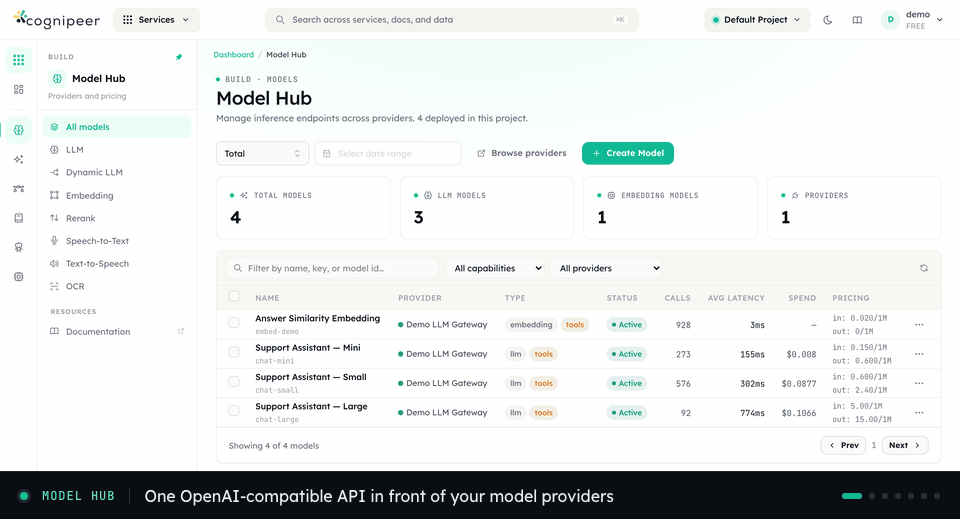

# Cognipeer Console

**Self-hosted, open-source AI gateway and control plane: OpenAI-compatible LLM routing, RAG, an MCP hub, guardrails and agent tracing for multi-tenant teams.**

[](LICENSE)
[](https://github.com/Cognipeer/console/tags)
[](https://github.com/Cognipeer/console)
[](https://docs.cognipeer.com/console/)

[Docs](https://docs.cognipeer.com/console/) · [Quick start](#quick-start) · [Discussions](https://github.com/Cognipeer/console/discussions) · [Changelog](CHANGELOG.md) · [Contributing](CONTRIBUTING.md) · [Contact](mailto:developer@cognipeer.com)

**Adoption:** in active use at 15 companies that Cognipeer supports as enterprise customers. Open-source users are not included in this count.

<p align="center"></p>

Community edition is available under AGPL-3.0. Commercial licensing, hosted deployments, and support agreements are available separately through Cognipeer.

## Features

**Gateway**
- **LLM Gateway** — OpenAI-compatible chat completions, embeddings, batch, and moderations across OpenAI, Anthropic, AWS Bedrock, Google Vertex AI, vLLM, Ollama, and more
- **Model Hub & Dynamic Routing** — Fallback chains and per-model quota/rate limiting
- **Realtime** *(Enterprise)* — WebSocket voice agents with barge-in and tool-call events

**Agents & Automation**
- **MCP Hub** — Curate, host, and discover Model Context Protocol servers (OpenAPI, remote, stdio) with per-tool controls
- **Sandbox** *(Enterprise)* — Isolated runtime environments for code, agents and previews with snapshot/fork/resume and port-forwarded previews
- **Browser Automation** — Managed browser profiles, live sessions, and per-browser MCP endpoints
- **A2A Protocol** — Publish Console-managed agents as Agent-to-Agent servers with agent cards
- **Prompt Management** — Versioned templates with environment-based deployment (dev/staging/prod); the Prompt Optimizer is Enterprise

**Knowledge & Retrieval**
- **RAG / Knowledge Engine** — Document ingestion, chunking, embedding, and retrieval
- **Web Crawler & Web Search** — Scheduled or ad-hoc crawling plus a built-in search provider
- **Vector Store Management** — Multi-provider vector operations (Pinecone, Chroma, Qdrant, and more) with built-in SQLite vector support
- **OCR & Rerankers** — Layout/table-aware document extraction and Cohere-compatible reranking
- **Semantic Memory** — Scoped memory stores with vector-based recall

**Observability & Evaluation**
- **Agent Tracing** — Batch and streaming ingest, OTLP/HTTP JSON, and an OpenTelemetry exporter
- **Evaluations** — Datasets, AI-assisted labeling, and accuracy scoring
- **Inference Monitoring & Alerts** — Real-time monitoring for self-hosted inference servers with rule-based alerting

**Safety & Compliance**
- **Authorization Engine** — Roles, group grants, project permissions and API token scopes are decided by one policy engine (Cedar) on every request, with custom allow/deny policies, an access check, decision ids on every refusal and an audit trail ([docs](docs/guide/authorization.md))
- **Guardrails** — PII detection, content moderation, prompt shields, and custom LLM-based evaluators
- **AI Red-Teaming** — OWASP LLM Top 10 probes, campaigns, and attack runs
- **Audit Logging** — Tenant-scoped audit trails

**Infrastructure & Cost**
- **GPU Fleet** *(Enterprise)* — Pooled GPU inference with MIG slicing, Hugging Face catalog deploys, and capacity planning
- **Cost & Optimization** *(Enterprise)* — Budgets and automated optimization prescriptions on top of spend and usage tracking
- **Multi-Tenant Architecture** — Complete data isolation per tenant, projects and groups; SSO (OIDC) and LDAP sign-in are Enterprise
- **File Management** — Multi-provider file storage with automatic Markdown conversion
- **Quota & Rate Limiting** — Multi-dimensional quota enforcement with plan-level defaults

## Editions

This repository is the **Community Edition**, licensed under AGPL-3.0. The commercial **Enterprise Edition** adds Sandbox, Realtime, GPU Fleet, Cluster (multi-node), Cost & Optimization, Prompt Optimizer, AI App Gateway, Portals, Channels, Service Reports, Entity Health, Data Retention, Single Sign-On (OIDC) and LDAP Directory. In a community build these pages show an upgrade notice. See [COMMERCIAL.md](COMMERCIAL.md) for commercial terms.

## Quick Start

### Prerequisites

- Node.js 20+
- npm

### Installation

```bash
git clone https://github.com/Cognipeer/console.git
cd console
npm install
cp .env.example .env.local
npm run dev
```

Set `JWT_SECRET` and `PROVIDER_ENCRYPTION_SECRET` in `.env.local` to two different random values of at least 32 characters (for example `openssl rand -hex 32`). Development starts without them and logs a warning; production refuses to start.

The gateway starts with **SQLite by default** — no external database required.

Visit [http://localhost:3000](http://localhost:3000) to access the dashboard.

### Docker

Docker Compose reads its variables from `.env`. Create it with two independent secrets, then start:

```bash
printf 'JWT_SECRET=%s\nPROVIDER_ENCRYPTION_SECRET=%s\n' "$(openssl rand -hex 32)" "$(openssl rand -hex 32)" > .env
docker compose up -d
```

Or build and run manually with the same `.env`:

```bash
docker build -t cognipeer-console .
docker run -p 3000:3000 -v ./data:/app/data --env-file .env cognipeer-console
```

Keep both values: changing `PROVIDER_ENCRYPTION_SECRET` later makes stored provider credentials unreadable, and changing `JWT_SECRET` signs everyone out.

## Architecture

```
┌────────────────────────────────────────────────────┐
│                    Next.js App                      │
├──────────────┬──────────────┬──────────────────────┤
│  Dashboard   │  Client API  │    Dashboard API     │
│   (UI)       │ /client/v1/* │    /api/*            │
├──────────────┴──────────────┴──────────────────────┤
│                  Middleware                         │
│         (JWT Auth + Feature Gates + CORS)           │
├────────────────────────────────────────────────────┤
│                 Service Layer                       │
│ Models │ Vector │ Knowledge Engine │ Memory │ Tracing │
├────────────────────────────────────────────────────┤
│              Provider Registry                      │
│  Contracts → Runtimes (LLM, Vector, File)          │
├────────────────────────────────────────────────────┤
│             Database Abstraction                    │
│           SQLite (default) │ MongoDB               │
├────────────────────────────────────────────────────┤
│               Core Infrastructure                   │
│  Config │ Logger │ Cache │ Resilience │ Health     │
└────────────────────────────────────────────────────┘
```

### Technology Stack

- **Framework**: Next.js 15 (App Router) + TypeScript
- **UI**: Mantine v8 + Tailwind CSS
- **Database**: SQLite (default, zero-dependency) or MongoDB
- **Auth**: JWT (jose) + API tokens
- **Authorization**: Cedar policy engine (WebAssembly) deciding every request
- **Cache**: None / Memory / Redis
- **Logging**: Winston with structured context

## Configuration

All configuration is managed through environment variables. See [.env.example](.env.example) for the full list.

Key variables:

| Variable | Default | Description |
|----------|---------|-------------|
| `DB_PROVIDER` | `sqlite` | Database backend (`sqlite` or `mongodb`) |
| `JWT_SECRET` | — | **Required**. Secret for JWT signing |
| `MAIN_DB_NAME` | `cgate_main` | Main database name |
| `CACHE_PROVIDER` | `memory` | Cache backend (`none`, `memory`, `redis`) |
| `RATE_LIMIT_PROVIDER` | `mongodb` | Rate limit backend (`mongodb`, `memory`, `redis`) |
| `BROWSER_BLOCK_PRIVATE_NETWORK` | `true` | Block private-network egress from managed browser sessions |
| `CORS_ENABLED` | `false` | Enable CORS for client APIs |
| `TRUSTED_PROXIES` | — | Reverse proxies or load balancers whose `X-Forwarded-For` is trusted; token IP allowlists and IP rules in access policies depend on it |

For the full configuration reference, see the [Configuration Guide](docs/guide/configuration.md).

## Client API

The gateway exposes an OpenAI-compatible API at `/api/client/v1/`:

```bash
# Chat completion
curl -X POST http://localhost:3000/api/client/v1/chat/completions \
  -H "Authorization: Bearer <API_TOKEN>" \
  -H "Content-Type: application/json" \
  -d '{"model": "gpt-4", "messages": [{"role": "user", "content": "Hello"}]}'

# Embeddings
curl -X POST http://localhost:3000/api/client/v1/embeddings \
  -H "Authorization: Bearer <API_TOKEN>" \
  -H "Content-Type: application/json" \
  -d '{"model": "text-embedding-3-small", "input": "Hello world"}'
```

See [openapi.yaml](openapi.yaml) for the full API specification.

## Official SDK

If you are building an application against Cognipeer Console, prefer the official TypeScript/JavaScript SDK:

- SDK repo: [console-sdk](https://github.com/Cognipeer/console-sdk)
- SDK docs: [docs.cognipeer.com/console-sdk](https://docs.cognipeer.com/console-sdk/)

Use this repository and its docs for platform setup, deployment, providers, tenancy, auth, and raw HTTP API semantics.

## Documentation

Full documentation is available in the [docs/](docs/) directory:

- [Getting Started](docs/guide/getting-started.md)
- [Architecture](docs/guide/architecture.md)
- [Configuration](docs/guide/configuration.md)
- [Deployment](docs/guide/deployment.md)
- [Multi-Tenancy](docs/guide/multi-tenancy.md)
- [Authorization](docs/guide/authorization.md) and [Upgrading to the policy engine](docs/guide/upgrading-to-the-policy-engine.md)
- [API Reference](docs/api/overview.md)
- [Licensing](docs/guide/licensing.md)
- [Security](docs/guide/security.md)

Build and preview the documentation site:

```bash
npm run docs:dev
```

## Contributing

See [CONTRIBUTING.md](CONTRIBUTING.md) for development guidelines, code style, and PR checklist.

## Security

Security reporting guidance is in [SECURITY.md](SECURITY.md). Do not disclose vulnerabilities in public issues.

## Cognipeer open-source projects

| Project | What it does |
| --- | --- |
| [console-sdk](https://github.com/Cognipeer/console-sdk) | TypeScript SDK for the Cognipeer Console API |
| [agent-sdk](https://github.com/Cognipeer/agent-sdk) | Lightweight, message-first agent runtime |
| [agent-server](https://github.com/Cognipeer/agent-server) | Ready-made REST API layer for AI agents |
| [chat-ui](https://github.com/Cognipeer/chat-ui) | React chat UI components for AI agents |
| [to-markdown](https://github.com/Cognipeer/to-markdown) | Convert PDF, Office, HTML and more to Markdown for LLM pipelines |
| [graph-builder](https://github.com/Cognipeer/graph-builder) | Turn text sources into a queryable graph |
| [cognipeer-observability](https://github.com/Cognipeer/cognipeer-observability) | Drop-in agent tracing for LangChain, LangGraph, OpenAI Agents and OpenTelemetry |

If this project is useful to you, a ⭐ on GitHub helps other developers find it.

Questions or enterprise support: [developer@cognipeer.com](mailto:developer@cognipeer.com).

## License 

This repository is licensed under the GNU Affero General Public License v3.0. See [LICENSE](LICENSE) for the full text.

If you want to embed Cognipeer Console in a closed-source product, offer a proprietary hosted derivative without AGPL obligations, or purchase support/SLA coverage, see [COMMERCIAL.md](COMMERCIAL.md)